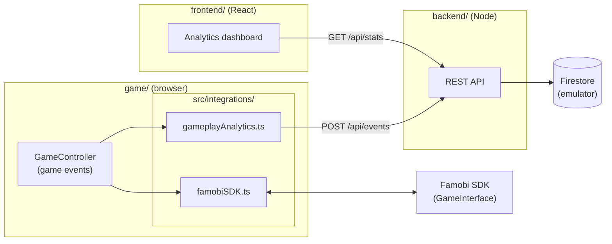

# Famobi Game SDK and Analytics

The Neon Snake browser game with the Famobi SDK integrated, gameplay analytics sent to a Node.js backend, stored in Firestore (Firebase Local Emulator Suite) and shown in a React dashboard.

| Folder | What it is | URL when running |
|---|---|---|
| `game/` | Neon Snake with the Famobi SDK and analytics integration | http://localhost:4173 |
| `backend/` | Node.js + Express API that validates and stores the analytics | http://localhost:3000 |
| `frontend/` | React analytics dashboard | http://localhost:5173 |
| `.docker/firebase/` | Firebase Local Emulator Suite (Firestore + Emulator UI) | http://localhost:4000 |

## How to install and run

The only requirement is **Docker** (with Docker Compose). Nothing else has to be installed locally, and no real Firebase project or credentials are needed: the backend uses the `demo-famobi-analytics` demo project, which only exists in the emulator.

```
git clone <this repository>
cd famobi_game_sdk_and_analytics
docker compose up --build
```

The first start takes a few minutes (Docker images and dependencies). The services start in order: the Firestore emulator first, then the backend once the emulator is healthy, then the game and the dashboard. The emulator configuration lives in [firebase.json](firebase.json) and [.firebaserc](.firebaserc).

Stop everything with `docker compose down`.

> The game loads the Famobi SDK from `https://api.games.famobi.com/init.js`, so the browser needs internet access. Everything else runs locally.

## How to test the complete flow locally

1. **Start everything** with `docker compose up --build` and wait until the backend logs that it is listening on port 3000. `curl http://localhost:3000/api/health` returns `{"status":"ok","firestore":"connected"}`.
2. **Play the game** at http://localhost:4173. Open the browser console: the Famobi local tester logs every SDK call (`[game] gameReady`, `gameStart`, `sendScore`, `sendProgress`, `gameEnd`, …). Play a run until you complete it, fail it, or go back to the menu.
3. **Check Firestore** in the Emulator UI at http://localhost:4000 → Firestore → collection `runs`: every run is one document with the fields of `runStarted` and `runEnded` merged into it.
4. **Check the dashboard** at http://localhost:5173 and press **Refresh**: the run appears in the overview and the charts.
5. **Optional, demo data:** with only a few own runs the charts are almost empty. `docker compose exec backend npm run seed` writes 665 realistic runs over the last 14 days (always the same data), so the dashboard has something to show.
6. **Unit tests:** `docker compose exec backend npm test` runs the 16 backend unit tests. The same tests and the type checks of all three projects run in GitHub Actions on every pull request ([.github/workflows/ci.yml](.github/workflows/ci.yml)).

The emulator keeps data only while it runs: after `docker compose down` the stored runs are gone.

## Main technical decisions

I worked step by step, with one feature branch per part. Each part has its own document with the details and the reasoning. I also documented my plan and the order of my work, to keep an overview of my time: see [docs/development-process.md](docs/development-process.md).

The following diagram shows the final architecture of the project.



1- SDK integration: steps, integration map and trade-offs are documented in [docs/sdk-integration.md](docs/sdk-integration.md).

2- Gameplay analytics: data model and where each value comes from are documented in [docs/gameplay-analytics.md](docs/gameplay-analytics.md).

3- Backend: API, Firebase data structure and validation are documented in [docs/backend.md](docs/backend.md).

4- Frontend: dashboard, KPIs, charts and the reasoning behind them are documented in [docs/frontend.md](docs/frontend.md).

## Assumptions and known limitations

- **A run is one attempt at one level** and a session is one page load. The game saves the unlocked level in `localStorage`, so the analytics cannot follow a player across visits (there is no player id).
- **`left` can be lost.** When the player leaves the page, the `runEnded` event is sent with the reason `left`, on `pagehide` with `fetch` + `keepalive`. If the browser is killed or the network is gone, the run stays without an end: it counts in "runs played", but not in rates and averages.
- **Time spent per run includes pauses.** On the dashboard it is the time between the start and the end of the run.
- **The game's dev server no longer works** (`pnpm dev`): the Famobi SDK has to load the built `game.js`, so the game container builds and serves the build, and rebuilds on file changes. See [docs/sdk-integration.md](docs/sdk-integration.md#1-start).
- **The SDK integration waits for the SDK by pausing the game** instead of changing the game's own flow, because I did not want to change the game code. Side effects (e.g. a short "Please wait" flash) are listed in [docs/sdk-integration.md](docs/sdk-integration.md#2-game).
- **No authentication or rate limiting** on `POST /api/events`: anyone who can reach the API can send events. The validation only guarantees that the data has the right shape.
- **Statistics are calculated from all runs on every request.** Fine locally, too slow and expensive with many runs (see [Scalability](docs/backend.md#scalability)).
- **Emulator data is not persisted** between restarts.
- **Not implemented from the Famobi docs:** requests, audio and storage, because they are outside the task's scope (see [docs/sdk-integration.md](docs/sdk-integration.md#4-not-in-scope)).

## What I would improve with more time

1. **Statistics that scale:** counters per day and level, updated when a run ends (`FieldValue.increment`), or Firestore aggregation queries, so the dashboard reads a few documents instead of all runs.
2. **More tests:** an API test (`POST /api/events` → `GET /api/stats`) against the emulator, unit tests for the SDK integration with a fake `GameInterface` (I verified it this way by hand), and one Playwright end-to-end test that plays a run and checks the dashboard.
3. **SDK integration inside the game flow:** let the `GameController` await the SDK before each transition, instead of holding the game with the system pause.
4. **Protect the events route:** rate limiting per IP and session, and the platform's player or session token instead of trusting the client.
5. **A persistent player id** next to `sessionId`, to count returning players and follow progress across visits.
6. **Dashboard filters:** time range and level, plus the points scored within a run (end score minus the score at level start).
7. **Production setup:** production Docker images (built files instead of dev servers), persisted emulator data (`--import` / `--export-on-exit`) and a working game dev mode.

## Use of external tools

I worked with an AI-assisted workflow: I used the agent **Claude Code** (Anthropic) during the whole development lifecycle. I gave it mainly the coding, so that I could focus on interpreting the requirements, making the decisions and designing the application and the code. I used it for:

- reading and summarizing the Famobi SDK docs and the game code, and mapping game events to SDK calls;
- generating boilerplate and first versions of the code (SDK adapter, analytics client, Express routes, zod schemas, React components, Docker and CI configuration, seed script, unit tests);
- checking the work: running scripted scenarios against a fake `GameInterface`, calling the API with `curl`, and taking dashboard screenshots at different screen widths;
- the documentation: correcting grammar, rewording text and turning my questions and chat messages into documentation.

I interpreted the requirements and made these decisions myself:

- **Architecture:** before handing over any coding, I planned what the architecture should look like.
- **Infrastructure:** the app had to be easy to run for the reviewers, and the job asks for CI/CD experience, so I decided to containerize the application.
- **Data model:** which names make sense, and how the data has to be stored to calculate the KPIs.
- **KPIs:** what makes sense to show. I did not hand this to the AI, but I compared my KPIs with its suggestion; the comparison is in [docs/frontend.md](docs/frontend.md#my-kpis-compared-with-the-ais-suggestion).
- **Scope:** while coding, the AI sometimes writes more complex code than I would and goes beyond the scope, so I have to stay critical, ask for changes and set rules for how it should work. One example: for the SDK integration, Claude Code first changed the game code, adding a new `gameplayTransitionGate.ts` and making the `GameController` methods wait for the SDK. I did not want to change the game code, so I asked for alternatives and chose the one that only listens to the game's existing events and reuses its system pause. I documented the trade-offs in [docs/sdk-integration.md](docs/sdk-integration.md#2-game). This kind of decision needs a person who knows their limits and has the bigger picture of the task and the time.
- **Review:** I reviewed the code critically and tested it by hand.

I can explain and change every part of the code.
