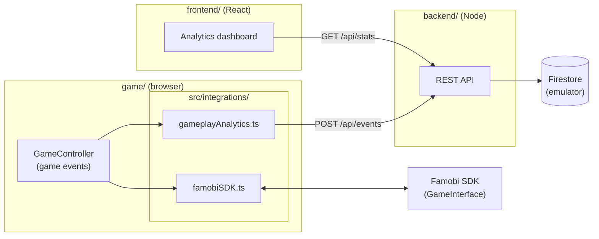

# famobi_game_sdk_and_analytics

Steps/Decisions

1- Do the unknown first, research for unknown tecnologies, play around with the SDK and read famobi SDK integration

Before starting, I needed a big picture of how the whole application would work:

The game exchanges information with two tools: the Famobi SDK and my own analytics. That is why both live in `game/src/integrations/` and follow the same pattern: they listen to the game's existing events, so the game code stays unchanged.

2- SDK integration: steps, integration map and trade-offs are documented in [docs/sdk-integration.md](docs/sdk-integration.md).

3- Gameplay analytics: data model and where each value comes from are documented in [docs/gameplay-analytics.md](docs/gameplay-analytics.md).

4- Before backend: containerization. I decided to containerize everything (game, backend and Firebase emulator) so the whole project runs with one command during the review, `docker compose up --build`, without installing any dependency except Docker. Details in [docs/backend.md](docs/backend.md#containers).

5- Backend: API, Firebase data structure and validation are documented in [docs/backend.md](docs/backend.md).

6- Frontend: dashboard, KPIs, charts and the reasoning behind them are documented in [docs/frontend.md](docs/frontend.md).
