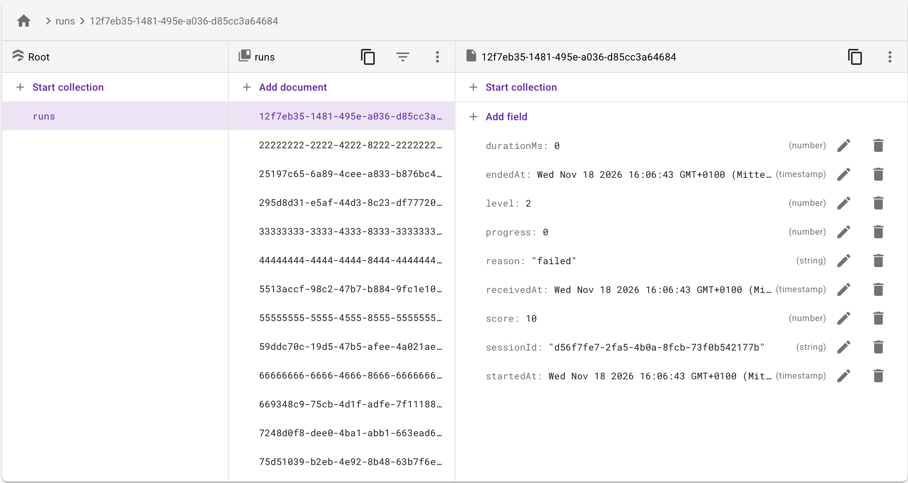

# Backend

[← Back to README](../README.md)

## Task

> Create a Node.js backend that receives the gameplay analytics and stores them in Firebase.
>
> You are responsible for defining:
>
> - the API;
> - the Firebase data structure;
> - how incoming data is checked and handled;
> - how the stored data is prepared for the frontend.
>
> The solution only needs to run locally. Deployment is not required.

## Stack

Node.js 24, Express 5, TypeScript, firebase-admin (Firestore), zod (validation). Runs in Docker, see [Containers](#containers).

## Containers

Everything starts with one command from the repository root:

```bash
docker compose up --build
```

| Service | URL | What it is |
|---|---|---|
| `game` | http://localhost:4173 | Neon Snake with the Famobi SDK and the analytics client. Rebuilt automatically on code changes |
| `backend` | http://localhost:3000 | Express API. Restarts automatically on code changes |
| `firebase` | http://localhost:4000 | Firebase Emulator UI (Firestore runs on port 8080) |
| `frontend` | http://localhost:5173 | React analytics dashboard, see [frontend.md](frontend.md) |

The emulator starts empty. To fill it with two weeks of demo runs:

```bash
docker compose exec backend npm run seed
```

- [docker-compose.yml](../docker-compose.yml) starts the emulator first and the backend once Firestore answers.
- Configuration comes from environment variables set in `docker-compose.yml` (no secrets, so they are committed). Each app validates them at startup and stops with a clear error if one is missing; `backend/.env.example`, `game/.env.example` and `frontend/.env.example` list them for running a service outside Docker.
- The Firebase project is `demo-famobi-analytics`. Firebase treats `demo-*` projects as offline-only, so no real Firebase project and no credentials are needed.
- Files: [.docker/firebase/Dockerfile](../.docker/firebase/Dockerfile), [backend/Dockerfile](../backend/Dockerfile), [game/Dockerfile](../game/Dockerfile), [frontend/Dockerfile](../frontend/Dockerfile), [firebase.json](../firebase.json).

## API

| Route | Status | Purpose |
|---|---|---|
| `GET /api/health` | done | Returns `{ "status": "ok", "firestore": "connected" }` when the API can reach Firestore |
| `POST /api/events` | done | Receives one `runStarted` or `runEnded` event and stores it. `202` when saved, `400` when invalid |
| `GET /api/stats` | done | Everything the dashboard shows, in one response: `overview` (total runs and one row per level), `runsPerDay` (last 14 days, UTC), `failedRunsPerLevel` (failed runs and failed rate per level) |

> **Verified:** this is how I validated that the first route worked: I played the game at http://localhost:4173 and checked the Firestore Emulator UI (http://localhost:4000). Each run appears as a document in `runs`, with the fields of both events merged into it (here a failed run on level 2).
>
> 

## Folder structure

Why it is organized like this: see [Architectural decisions](#architectural-decisions).

```
backend/src/
├── server.ts                 starts the HTTP server
├── app.ts                    Express app: JSON parser, routers, error handler
├── firestore.ts              Firestore client (emulator)
└── features/
    ├── health/
    │   └── healthRouter.ts       GET /api/health
    ├── events/
    │   ├── eventsRouter.ts       POST /api/events: validate, save, answer
    │   ├── runEventSchema.ts     validation rules and event types (zod)
    │   ├── runEventSchema.test.ts
    │   └── runRepository.ts      the only file that reads and writes runs in Firestore
    └── statistics/
        ├── statisticsRouter.ts   GET /api/stats
        ├── runStatistics.ts      turns stored runs into dashboard-ready numbers
        └── runStatistics.test.ts
scripts/
└── seedRuns.ts                   demo data: npm run seed
```

## Firebase data structure

One collection, `runs`, with one document per run. The document id is the `runId`.

```
runs/{runId}
  sessionId:   string
  level:       number
  startedAt:   Timestamp    from runStarted.occurredAt
  endedAt:     Timestamp    from runEnded.occurredAt (missing while the run has not ended)
  reason:      'completed' | 'failed' | 'left'
  score:       number
  progress:    number       0-1
  durationMs:  number
  receivedAt:  Timestamp    server time of the last write
```

- `runStarted` creates the document, `runEnded` adds the end fields. Both are written with `merge`, so the arrival order does not matter: a `runEnded` that arrives before its `runStarted` still produces a complete run.
- A duplicated event writes the same values onto the same document, so no duplicates are stored.
- A run without `endedAt` was started but never ended (e.g. the browser was killed before `pagehide`).

**Why "run" and not "gameplay":** at first I wanted to call it "gameplay", like the task does. But one gameplay (a visit to the game) can contain several runs, and the game code itself already calls an attempt a run (`runStarted`, `runEnded`). I kept the game's name so that the game, the analytics, the database and the dashboard all use the same word.

## Incoming data

- `express.json` accepts JSON bodies up to 10 kB. Invalid JSON or a larger body is answered with `400` / `413`.
- [runEventSchema.ts](../backend/src/features/events/runEventSchema.ts) checks every field with zod: a known `type`, UUIDs, level 1-3, an ISO date in `occurredAt`, `reason` from the three values, `score` and `durationMs` as whole numbers >= 0, `progress` between 0 and 1. Unknown fields are rejected.
- A `400` response lists every invalid field:

```json
{ "error": "Invalid event", "issues": [{ "field": "level", "message": "Too big: expected number to be <=3" }] }
```

## Tests and CI

Run the tests inside the backend container:

```
docker compose exec backend npm test
```

16 unit tests with Node's built-in test runner (`node:test`), so no extra test library is needed. They cover the two places where the backend makes decisions:

- **`runEventSchema`** (incoming data): valid events pass, and bad input is rejected with the right field: unknown event type, a level the game does not have, ids that are not UUIDs, a wrong date format, missing end fields, an unknown reason, progress above 100 % and unknown fields. The validation is the backend's main protection against bad data.
- **`calculateRunStatistics`** (data prepared for the dashboard): every number on the dashboard comes from this function, so the tests check each one with small hand-made runs: the per-level overview (runs, average time, completed, left, average progress), runs that have not ended (counted in runs played, but not in rates and averages), failed runs per level with their rate, runs per day in UTC including days without runs, and empty data (zeros and `null` instead of dividing by zero).

Both are pure functions: no Firestore and no HTTP server are needed, so the tests run in well under a second. Firestore access (`runRepository.ts`) and the routes are not unit tested; they were checked by hand against the emulator (see [API](#api)). An API test against the emulator is the next step.

**CI** (`.github/workflows/ci.yml`, GitHub Actions) runs on every pull request and on pushes to `main`. The backend job runs the type check and the tests, the game job runs the type check and the build, and the frontend job runs the type check.

## Architectural decisions

1. **Feature-based architecture with three small files per feature.** Each feature in `features/` (`health/`, `events/`, `statistics/`) keeps its code together. Inside, each file has one job: the router handles HTTP, the schema checks the data, the repository talks to Firestore. I compared it with two other designs:
    - **Clean Architecture** does not fit, because the app has no complicated business use cases: an event is received, checked and stored. Use cases, controllers and services would mostly pass calls along.
    - **Hexagonal Architecture** (ports and adapters) does not fit either. Its main benefit is swapping technologies, but Firestore is not meant to change here, the business rules are simple, and there are no clearly separated technical layers to put behind ports.
2. **zod for validation.** The schema is both the runtime check and the TypeScript type (`z.infer`), so the two cannot drift apart, and its error messages go straight into the `400` response.
3. **One event per request.** A run produces only two events, minutes apart, so batching would add a client queue and partial-failure handling without a real benefit.
4. **One `runs` document per run, written with `merge`.** Arrival order and duplicated events do not matter, which also removes the need for an event id.
5. **No separate raw event storage.** The dashboard only needs the state of each run. If an audit trail were needed, an `events` subcollection under each run could be added.
6. **Statistics are prepared in the backend, in one route.** `GET /api/stats` returns the numbers in the shape the charts need, so the dashboard only formats them. One route means one request and one place to explain; the statistics are computed on each request from all runs, which is fine locally (see Scalability).
7. **Reproducible demo data.** `npm run seed` simulates sessions like the real game (start at level 1, next level after completing, sometimes retry after failing), with the real fruit targets and scoring. A fixed random seed gives every reviewer the same data. It writes through the same repository functions as the API.

## Scalability

The current setup is made for local use. What would change with real traffic:

1. **Receiving events.** The API is stateless, so more instances can run behind a load balancer. Document ids are random UUIDs, which spreads writes evenly in Firestore. With very high traffic, a queue (e.g. Google Pub/Sub) between the API and Firestore would absorb spikes, and the game would send events in batches.
2. **Statistics.** Computing statistics by reading every run on each dashboard request is fine locally, but gets slower and more expensive as runs grow (Firestore charges per document read). At scale: Firestore aggregation queries (`count`, `sum`, `average`) computed on the server, or counters updated when a run ends (e.g. one document per day and level, incremented with `FieldValue.increment`), so the dashboard reads a few documents instead of all runs. For deeper analysis, an export to BigQuery.
3. **Abuse.** Validation rejects malformed data, but anyone can still send fake events. In production: rate limiting per IP or session, and possibly a signed token from the game.
4. **Data growth.** Old runs could expire automatically (Firestore TTL policies) once they are counted in the aggregated statistics.
5. **Deployment.** The game, the API and the dashboard are already separate containers and would be deployed separately: the game as static files on Famobi's CDN, the API as its own service, the dashboard as an internal app behind a login. Game and API on different domains would require CORS on the API.

---

[← Back to README](../README.md)
