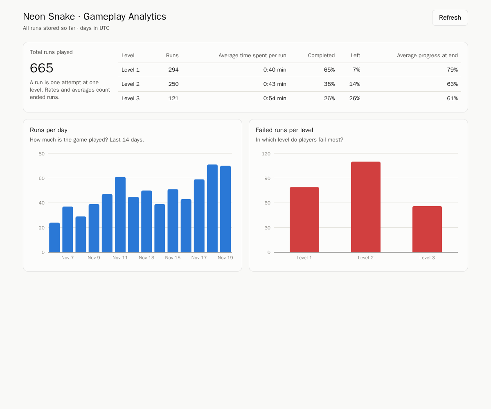

# Frontend

## Task

> Create a React frontend that consumes the backend and presents useful gameplay insights.
>
> The dashboard should include a short overview and at least two meaningful graphs. You may decide which metrics and visualizations provide the most useful picture of the game activity.
>
> The dashboard does not need to be visually elaborate. We are more interested in clarity, usability, and the reasoning behind your choices.

## Stack

React 19, TypeScript, Vite, Recharts. Runs in Docker as the `frontend` service at http://localhost:5173 (see [backend.md](backend.md#containers)).

The dashboard reads everything from one backend route, `GET /api/stats`. The Vite dev server forwards `/api` to the backend, so dashboard and API share one origin (no CORS), the same setup as the game.

## What the dashboard answers

A game platform wants to know three things: **how much is the game played, do players succeed, and where do they struggle or give up?** Every element of the dashboard answers one of these, per level.



A **run** is one attempt at one level, from `runStarted` to `runEnded`. Rates and averages count ended runs only, so runs that are still going (or never sent an end) do not count as failures.

### KPI decision

At first I thought about building the overview per **session** (one page load): sessions, runs per session, sessions that beat the game. I noticed that it does not make sense for this game: the game saves the unlocked level in `localStorage`, so a new session can start directly at level 3, and "a session that beat the game" can be a two-minute visit. Session numbers would mix up very different visits.

So I went with **runs** (one attempt at one level). A list of single runs alone does not say much, so I **aggregate them per level**: the levels behave very differently, and one overall number would hide where players struggle. The overview shows the total runs played and, for each level:

- **Runs:** how many attempts reach the level.
- **Average time spent per run:** how long an attempt takes.
- **Completed** and **Left** (failed is the rest): whether players succeed or give up.
- **Average progress at end:** how far into the level players get. I used progress instead of score because the score has no maximum and carries over between levels.

The two charts complete it: **runs per day** (is the game played, and is it growing?) and **failed runs per level** (in which level do players fail most?).

### Overview: total runs and one row per level

| Column | Calculation | Why |
|---|---|---|
| Total runs played | number of runs | overall activity |
| Runs (per level) | runs of the level | how many attempts reach each level |
| Average time spent per run | mean `durationMs` of ended runs | how long an attempt takes; a level that suddenly takes much longer is a difficulty signal |
| Completed | completed ÷ ended runs | is the level too hard or too easy? |
| Left | left ÷ ended runs | how often players give up during the level, the drop-off signal |
| Average progress at end | mean `progress` of ended runs (fruit eaten ÷ target) | covers "score or progress" from the task, as a percentage that can be compared between levels |

Failed is the rest (100 % − completed − left), so all three outcomes of the task are visible.

### Charts

| Chart | Form | Question |
|---|---|---|
| Runs per day | bars, last 14 days | How much is the game played, and is it growing? |
| Failed runs per level | one bar per level with the number of failed runs; the tooltip adds the failed rate (failed ÷ ended runs) | In which level do players fail most? |

## Folder structure

```
frontend/src/
├── main.tsx                         mounts the app
├── App.tsx                          loads the statistics; loading, error and empty states; layout
├── styles.css                       layout and colors (light and dark mode)
├── api/
│   └── fetchRunStatistics.ts        GET /api/stats and its response type
└── components/
    ├── LevelOverviewTable.tsx
    ├── RunsPerDayChart.tsx
    ├── FailedRunsPerLevelChart.tsx
    └── chartTheme.ts                shared chart colors, axis and tooltip style
```

## Decisions

1. **Recharts instead of Nivo.** I reasoned between Recharts and Nivo, the chart library I already have experience with, and decided for Recharts because the dashboard does not need complicated diagrams: only bar charts. Recharts builds them from plain React components (`<BarChart><Bar dataKey="level1" /></BarChart>`), is fully typed, has tooltip, legend and responsive sizing built in, and is the most widely used React chart library.
2. **Overview per level, not per session.** See [KPI decision](#kpi-decision). The levels behave very differently (level 3 is completed far less often and left far more often than level 1), and one overall number would hide that.
3. **A table for the overview, not KPI tiles.** Five values for three levels are 15 numbers: too many for tiles, but easy to compare down the columns of a table.
4. **Progress instead of score.** The score has no maximum and carries over between levels, so a level 3 score includes levels 1 and 2. Progress (fruit eaten ÷ target) is a percentage of the level itself and can be compared between levels.
5. **Failed runs per level as a simple bar chart.** My first version showed *where inside* a level players fail (failed runs per progress range, as a share per level). It was hard to read at a glance, so I replaced it with the simpler question "in which level do players fail most?": one bar per level, counted, with the failed rate in the tooltip. The count shows where most failures happen in total; the rate (in the tooltip, and together with Completed and Left in the overview) shows how hard each level is, independent of how many runs reach it.
6. **Runs per day over 14 days.** Long enough to see a trend, short enough to read each day. Days are UTC dates, the same in the backend and the dashboard.
7. **Readable and accessible charts.** Both charts have one series in one color, with a separate step for dark mode: blue for runs, red for failed runs (red because it means failure; both checked for contrast against the chart background), and the axes name every bar, so no information depends on color alone. Bars are not animated: with Recharts 3 bars stayed invisible while the entry animation was on, and the data should be visible immediately anyway.
8. **Responsive layout.** The charts resize with their container and sit side by side only when there is room. The total sits beside the table from tablet width; on phones each level becomes its own block of "label: value" lines, so no column is cut off.
9. **Loading, error and empty states.** The dashboard explains what is happening instead of showing empty charts: "Loading…", "Is the backend running?", or how to add demo data.

> **Verified:** I opened the dashboard with seeded data in light mode, dark mode and at 390, 768 and 1200 px width (screenshot above): all charts render, the layout has no horizontal scrolling, and there are no browser console errors.
